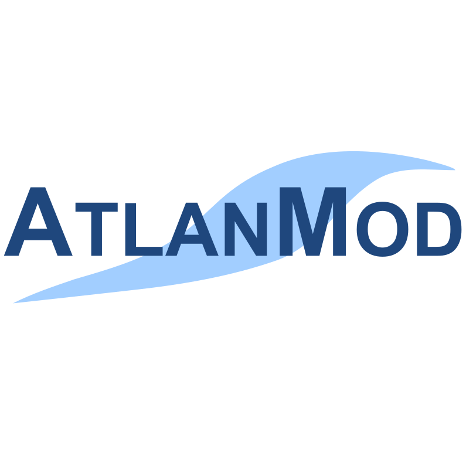

I have published more than 100 international articles (h-index: 27). 

You can find the list of my publications on [DBLP](http://dblp.uni-trier.de/pers/hd/t/Tisi:Massimo), some stats on [Google Scholar](https://scholar.google.fr/citations?user=5-tRnxkAAAAJ&hl=en), and some of the pdfs in free access down here.
 
 

<!--<table width="100%">
<tr>                      
 	<td width="30%"/>
	<td></td>
	<td></td>
    <td> </td>
    <td width="100px"></td>
 	<td width="30%"/>
</tr>
</table> -->

<iframe frameborder="no" border="0" marginwidth="0" marginheight="0" width="100%" height="10000" src="https://api.archives-ouvertes.fr/search/?q=*:*&fq=authIdHal_s:massimo-tisi&fq=docType_s:(ART%20OR%20COMM%20OR%20POSTER%20OR%20PRESCONF%20OR%20OUV%20OR%20COUV%20OR%20PATENT%20OR%20OTHER%20OR%20UNDEFINED%20OR%20REPORT%20OR%20THESE%20OR%20HDR%20OR%20MEM%20OR%20LECTURE%20OR%20IMG%20OR%20VIDEO%20OR%20SON%20OR%20MAP%20OR%20PROCEEDINGS%20OR%20ISSUE%20OR%20BLOG%20OR%20NOTICE%20OR%20TRAD%20OR%20SOFTWARE%20OR%20CREPORT%20OR%20ETABTHESE%20OR%20MEMLIC%20OR%20NOTE%20OR%20OTHERREPORT%20OR%20REPACT%20OR%20SYNTHESE)&rows=1000&fl=halId_s,version_i,uri_s,docType_s,docSubType_s,doiId_s,title_s,authFullName_s,producedDate_s,thumbId_i,citationRef_s,linkExtUrl_s,linkExtId_s&facet=true&facet.mincount=1&facet.field=openAccess_bool&facet.field=primaryDomain_s&facet.field=keyword_s&facet.field=authFullNamePersonIDIDHal_fs&facet.field={!key=authIdHasPrimaryStructure_fs_11584-5451+facet.prefix=11584-5451}authIdHasPrimaryStructure_fs&facet.field=journalTitleId_fs&facet.field={!key=publicationDateY_i%20ex=tag_date}publicationDateY_i&facet.field=europeanProjectTitleId_fs&facet.field=mesh_s&sort=publicationDateY_i%20desc&f.publicationDateY_i.facet.sort=index&wt=html"/>

<!--
Here are my current favorites:

* Massimo Tisi, Zheng Cheng: [CoqTL: An Internal DSL for Model Transformation in Coq](https://hal.inria.fr/hal-01828344/document). ICMT 2018: 142-156
* Amine Benelallam, Abel Gómez, Massimo Tisi, Jordi Cabot:
[Distributing relational model transformation on MapReduce](https://hal.archives-ouvertes.fr/hal-01863885/document). Journal of Systems and Software 142: 1-20 (2018)
* Soichiro Hidaka, Frederic Jouault, Massimo Tisi: [On Additivity in Transformation Languages](https://hal.archives-ouvertes.fr/hal-01566259/document). MoDELS 2017: 23-33
* Zheng Cheng, Massimo Tisi: [Incremental Deductive Verification for Relational Model Transformations](https://hal.archives-ouvertes.fr/hal-01435974/file/PID4622069.pdf). ICST 2017
* Salvador Martínez, Massimo Tisi, Remi Douence: [Reactive model transformation with ATL](http://www.sciencedirect.com/science/article/pii/S016764231630106X). Science of Computer Programming (2017)
* Soichiro Hidaka, Massimo Tisi, Jordi Cabot, Zhenjiang Hu:
[Feature-based classification of bidirectional transformation approaches](https://hal.inria.fr/hal-01257169/file/bidirectionality.pdf). Software and System Modeling 15(3): 907-928 (2016)
* Massimo Tisi, Frédéric Jouault, Piero Fraternali, Stefano Ceri, Jean Bézivin:
[On the Use of Higher-Order Model Transformations](http://modeling-languages.com/wp-content/uploads/hot1.pdf). ECMDA-FA 2009: 18-33
-->

<!---->

